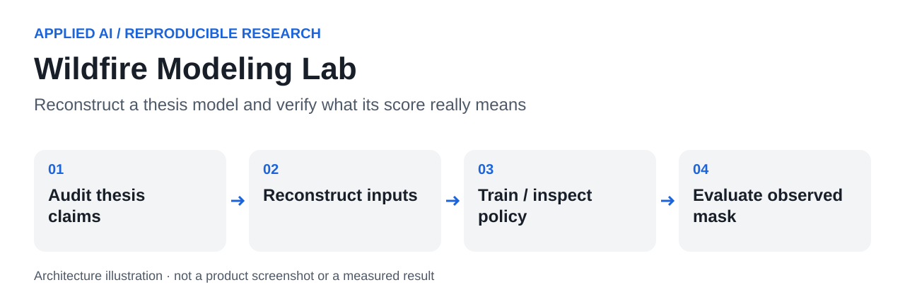

<a id="readme-top"></a>


# Wildfire Modeling Lab

**From a historical research result to an auditable implementation and evaluation protocol.**

This project investigates whether an environmental-reward DQN can reproduce spatial wildfire progression. It builds on my 2025 master's thesis, *Wildfire Spread Prediction Using Reinforcement Learning and Environmental Variables*, and now separates the historical thesis claim from newly executed software checks and the still-unverified real-event score.

| At a glance | |
|---|---|
| Research target | Uljin 2022 wildfire, with an additional Uiseong–Andong case described in the thesis |
| Thesis-reported result | Jaccard/IoU **0.726** for one reward-weight setting |
| Newly executed work | **6 DQN training runs, 960 episodes, 28,127 gradient updates**, synthetic inputs |
| Observed-event result | Held-out IoU **0.367** against a Sentinel-2 dNBR burn mask (spatial hold-out, unseen seeds); the thesis 0.726 is **not reproduced** |
| Stack | Python, PyTorch, NumPy, MATLAB research archive, Earth Engine export helper |

[Research case study](docs/case-study.md) · [Full thesis audit](docs/thesis-reproduction-audit.md) · [Architecture](docs/architecture.md) · [Results](docs/experiment-results.md) · [Data reconstruction](data/README.md)

## Table of Contents

- [About The Project](#about-the-project)
- [Getting Started](#getting-started)
- [Usage](#usage)
- [Roadmap](#roadmap)
- [Contributing](#contributing)
- [License](#license)
- [Contact](#contact)
- [Acknowledgments](#acknowledgments)

## About The Project

### Why I developed it

The research question is spatial progression after ignition: given environmental conditions, which neighboring cells does a learned policy favor, and how similar is the resulting footprint to an independently observed burned area? This is different from predicting whether a fire starts, placing firefighting resources or issuing an operational emergency forecast.

The original research used environmental information—temperature/humidity-derived equilibrium moisture, vegetation, wind and terrain—to shape the reward. The thesis reports an Uljin overlap score and a transfer case. The current engineering work asks a stricter question: can a reviewer identify the model, recover its inputs, run the training and independently check the reported score?

### What this enabled

- Define a 50×50 geographic grid, an ignition cell and nine possible moves, including staying.
- Connect environmental hypotheses to an explicit weighted reward and a learned action-value function.
- Compare simulated footprints with a spatial overlap metric rather than relying only on visual similarity.
- Identify and document the gap between a historical fitted result and a repeatable independent evaluation.

The thesis describes the first three research activities. The new audit, input contracts, unit tests, runnable PyTorch training and saved experiment logs make the fourth activity inspectable. The current implementation has not been validated for operational wildfire warning.

### Built With

Python 3.8.10, PyTorch 2.4.1+cpu, NumPy 1.23.5, SciPy 1.10.1 and Matplotlib 3.7.5 were used for the new runs. The older MATLAB scripts are retained as historical exploration, not relabeled as the recovered final thesis code.

### Model and technical decisions

The reward combines moisture, vegetation, slope alignment and wind alignment. A multilayer perceptron estimates nine Q-values from grid coordinates and six environmental features. Replay sampling, a target network, epsilon-greedy exploration, finite episodes and MSE TD loss are implemented explicitly.

The thesis specifies several components but not every implementation detail. The new 64×64 hidden layers and optimizer settings are documented reconstruction choices. Equation 3.7's NDVI units and equation 3.12's floor/ceiling conflict remain unresolved; experiments keep the printed and alternative NDVI interpretations separate.

### Code to inspect

| Entry point | What it makes inspectable |
|---|---|
| [`wildfire/model.py`](wildfire/model.py) | Units, coordinate convention, reward, adjacent transitions and IoU |
| [`wildfire/experiment.py`](wildfire/experiment.py) | Actual replay/target-network DQN training and checkpoint/log output |
| [`wildfire/rollout.py`](wildfire/rollout.py) | Separate parallel ignition-front reconstruction and provenance-gated scoring |
| [`wildfire/verify_thesis.py`](wildfire/verify_thesis.py) | Frozen checkpoint/mask hashes and observed-score calculation |
| [`data/prepare_dataset.py`](data/prepare_dataset.py) | Explicit CSV-to-tensor reconstruction without inventing labels |
| [`tests/test_model.py`](tests/test_model.py) | Boundary, units, barrier, terminal, provenance and metric behavior |

### AI-assisted engineering

AI development tools assist implementation and review, while the scientific claim depends on data provenance, a frozen protocol and actual evaluation. Writing a training script is not the same as recovering a model, and increasing reward is not the same as improving real-event spatial accuracy. These distinctions are part of the engineering work presented here.

## Getting Started

### Prerequisites

Python and the pinned packages in `requirements.txt`. CPU execution is supported. MATLAB is needed only for exploring the archived `.m` scripts. The Earth Engine source-reconstruction helper requires the user's authorized Earth Engine environment; it was not executed against an authenticated account here.

### Installation

```powershell
git clone https://github.com/hupositoc/wildfire-modeling-lab.git
cd wildfire-modeling-lab
python -m venv .venv
.venv\Scripts\Activate.ps1
python -m pip install -r requirements.txt
```

Run tests and the declared implementation benchmark:

```powershell
python -m unittest discover -s tests -v
python -m wildfire.experiment --episodes 160 --seeds 7 19 43
python tools/render_report.py
```

These commands generate synthetic environmental inputs. They do not recreate the original satellite-derived target or establish IoU 0.726. The recorded package versions and seeds support reproducibility on the same software stack; cross-platform bitwise identity is not promised.

## Usage



**Text equivalent:** audit the thesis → reconstruct environmental inputs → train and inspect a policy → evaluate a frozen model against an independently sourced mask.

### What actually ran

Two NDVI interpretations were each trained with seeds 7, 19 and 43 for 160 episodes. Every network was evaluated on five fixed synthetic environments withheld from the training generator's seed range. The evaluation includes random and immediate-reward policies. Raw logs, checkpoints and digests are in [`results/implementation-benchmark`](results/implementation-benchmark).


| NDVI interpretation | Policy | Mean return | Sample SD | Evaluation pairs |
|---|---|---:|---:|---:|
| literal | dqn | 0.101 | 67.181 | 15 |
| literal | random | 0.920 | 2.235 | 15 |
| literal | reward-greedy | 9.635 | 9.638 | 15 |
| raw | dqn | 93.546 | 108.608 | 15 |
| raw | random | 9.138 | 10.726 | 15 |
| raw | reward-greedy | 13.367 | 13.193 | 15 |


Return values are synthetic-environment diagnostics. They are **not** IoU, physical spread rates or evidence that DQN outperforms real wildfire models. Repeated rewards and staying can produce high returns without a useful spatial footprint, and the variability is substantial. The [results discussion](docs/experiment-results.md) explains this failure mode.

### Checking the historical score

Use the [data reconstruction procedure](data/README.md), resolve the [thesis audit findings](docs/thesis-reproduction-audit.md), then train on the declared input tensor. Freeze the checkpoint before opening the evaluation mask. `wildfire.verify_thesis` computes the actual overlap and difference from 0.726, retaining input/checkpoint hashes. It rejects synthetic or placeholder observed-mask provenance.

The old `actual_fire_data.mat` was generated by a stochastic MATLAB simulation and is not accepted as observation. The evaluation target is instead an independently built Sentinel-2 dNBR mask (`data/build_burn_mask.py`). `wildfire.calibrate` runs the thesis weight search against it. The JI term is used as a training reward only, a checkerboard spatial hold-out is reported separately, and the selected setting is re-trained on unseen seeds. The best configuration reaches **held-out IoU 0.367**, about the level a supervised classifier reaches on the same static inputs. See [observed-event calibration](docs/experiment-results.md#observed-event-calibration-uljin-2022), including the variants that were rejected.

## Roadmap

- [x] Review the complete thesis and inspect key equations as page images.
- [x] Implement testable reward, transitions, DQN training and a separate branching rollout.
- [x] Run six seeded synthetic implementation experiments and publish actual logs/figures.
- [x] Add explicit input reconstruction and observed-mask verification contracts.
- [ ] Recover the original final code, checkpoint, mask and preprocessing configuration.
- [ ] Resolve NDVI scale, diffusion rounding, time count and branching/reward semantics.
- [x] Calibrate on an observed Uljin burn mask with a spatial hold-out and unseen seeds (held-out IoU 0.367; 0.726 not reproduced).
- [ ] Add inputs that carry new information (forest type, ERA5-Land, VIIRS fire progression).
- [ ] Evaluate a frozen model on an independently reserved event and publish uncertainty/baselines.

## Contributing

For a reproduction issue, attach dataset provenance, config, seed, runtime versions, checkpoint hash and expected versus observed output. Do not adjust held-out masks, event boundaries or labels to reach a requested score. A proposed change to the model or preprocessing must say whether it reproduces the thesis, corrects an ambiguity or defines a new experiment.

## License

Existing source notices apply. A repository-wide license for all historical research material has not been selected. Third-party observational datasets retain their own terms and attribution requirements. The private thesis PDF and source imagery are not redistributed in this repository.

## Contact

[hupositoc](https://github.com/hupositoc) · [Research/reproduction issues](https://github.com/hupositoc/wildfire-modeling-lab/issues)

## Acknowledgments

The section order follows [Best-README-Template](https://github.com/othneildrew/Best-README-Template), under the Unlicense. See [the 50-repository review](docs/reference-review-50.md), [design rationale](docs/design-rationale.md), and [primary data/model references](docs/thesis-reproduction-audit.md#primary-references-for-source-reconstruction). The graphics are original and do not imply endorsement by Toss, KRDS, data providers or a certification body.


[Engineering decision record](docs/engineering-decisions.md) · [Review of 50 reference repositories](docs/reference-review-50.md)
