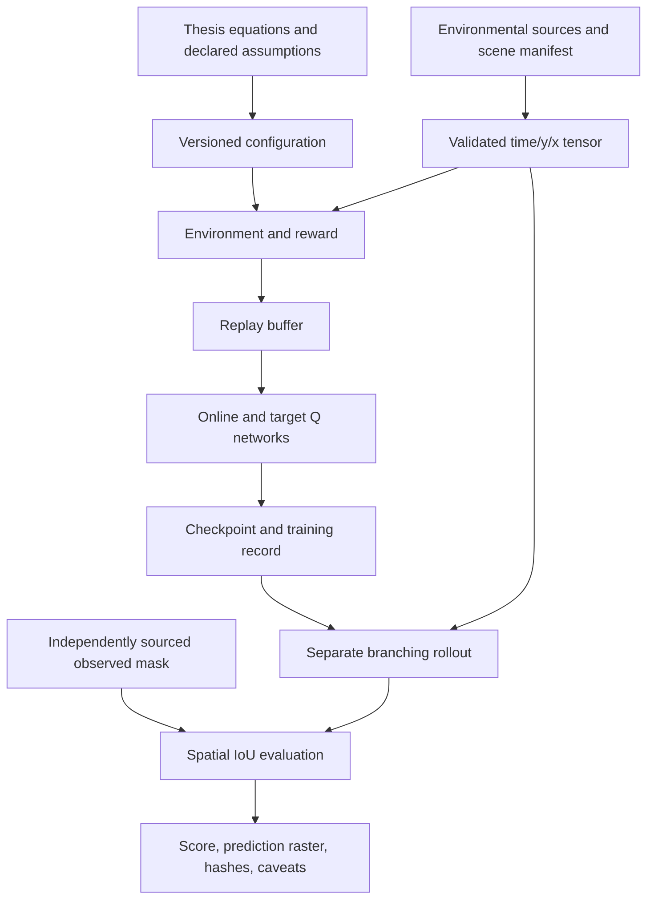

# Reconstruction architecture

The observed target is not an input to the synthetic training benchmark. The real-event evaluator requires a frozen checkpoint, input provenance and mask provenance. It records the score actually obtained rather than adjusting inputs to the reported target.

## Source modules

| Module | Responsibility |
|---|---|
| `wildfire/model.py` | Shape/range validation, coordinate convention, moisture and alignment rewards, diffusion budget, bounded path transitions, overlap metric |
| `wildfire/experiment.py` | Eight-input/nine-output MLP, epsilon-greedy selection, replay, target-network MSE learning, checkpoint/log persistence |
| `wildfire/rollout.py` | Independent ignition-front reconstruction, non-fuel barriers, positive-reward spread criterion and observed-mask provenance checks |
| `wildfire/verify_thesis.py` | Frozen-checkpoint digest verification, mask loading, actual IoU/difference calculation and prediction export |
| `data/export_earth_engine.js` | Raw-source export recipe for pre-event NDVI, terrain and hourly weather; requires authenticated execution |
| `data/prepare_dataset.py` | Explicit half-hour interpolation, wind-vector conversion, circular terrain-aspect handling and no-extrapolation checks |
| `tools/render_report.py` | Figures and summary tables read directly from saved runs |

## Units and grid

Arrays use `[time, y, x]`, with x east, y north and lower-left origin. Temperature is Celsius, RH is a 0..1 fraction, wind speed is m/s and model directions are degrees counterclockwise from east in the direction of travel. Weather u/v vectors are interpolated before direction conversion. GEE downhill aspect is converted explicitly to upslope direction.

The thesis describes approximately 100 m north/south and 117 m east/west cells. The current diffusion budget uses a declared scalar 100 m; resolving how the original used rectangular cell geometry is part of the audit. Each movement microstep is adjacent and cannot jump across a non-fuel cell.

## State, actions and termination

Eight observation values follow the stated coordinates-plus-six-environment description. Nine actions cover eight neighbors and staying. Reaching the AOI boundary or the finite horizon terminates path training; terminal transitions do not bootstrap. Repeated-cell rewards and missing explicit time in a changing environment remain modeling limitations, not silently corrected claims.

## What is not recovered

The hidden widths, optimizer settings, final checkpoint, exact branching/burn-residence behavior and observed-mask extraction parameters are not established as original. The separate rollout makes its choices visible but does not make the synthetic trajectory benchmark an exact final-footprint reproduction. See the audit before interpreting a score.
