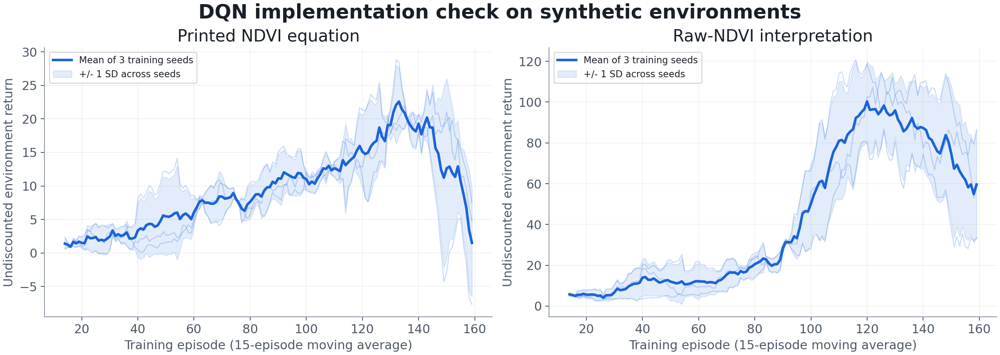
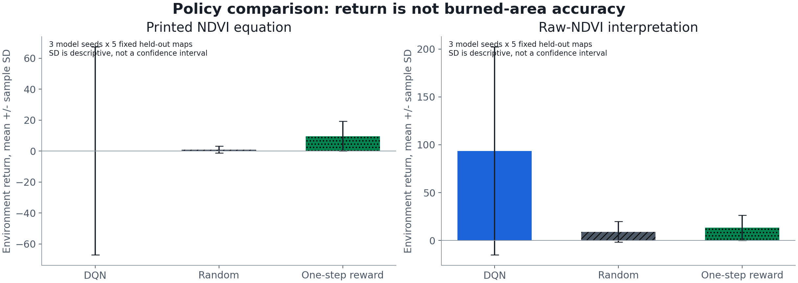

# Executed experiment results

## Protocol

This is an implementation benchmark with generated environments, not a reproduction of observed wildfire damage. The model uses the thesis's reported best reward weights and gamma=1, with declared missing details filled by explicit reconstruction choices. Two NDVI interpretations and three seeds give six runs. Each run contains 160 episodes and fixed, separate synthetic evaluation seeds 200001–200005.

- Runs: 6
- Training episodes: 960
- Gradient updates: 28127
- Recorded total training/evaluation wall time: 170.03 s on this CPU environment; not a benchmark against physical simulators.
- Real-event IoU: not part of this synthetic benchmark; see [Observed-event calibration](#observed-event-calibration-uljin-2022).

The trial settings were not chosen against IoU 0.726. No early stopping, best evaluation seed or best mask threshold was selected to manufacture a match.

## Training traces

Each panel shows a 15-episode moving average for three training seeds, their mean and descriptive standard deviation. Episode return is collected while exploration changes, so this curve is not a direct evaluation-accuracy curve. The small sample does not justify a general performance claim.

## Held-out synthetic environments

| NDVI interpretation | Policy | Mean return | Sample SD | Evaluation pairs |
|---|---|---:|---:|---:|
| literal | dqn | 0.101 | 67.181 | 15 |
| literal | random | 0.920 | 2.235 | 15 |
| literal | reward-greedy | 9.635 | 9.638 | 15 |
| raw | dqn | 93.546 | 108.608 | 15 |
| raw | random | 9.138 | 10.726 | 15 |
| raw | reward-greedy | 13.367 | 13.193 | 15 |

Each row summarizes 15 model-seed/environment pairs. These pairs are not 15 independent real fire events. The plotted SD describes dispersion and is not a confidence interval. The one-step reward policy is a deliberately simple baseline, not an optimized physical fire-spread simulator.

## Failure analysis

The printed NDVI interpretation has near-zero mean DQN return with very large variation; it does not consistently beat even the random baseline in this check. The raw-NDVI interpretation yields a much larger return, but the environment can reward remaining at or revisiting a favorable cell. More cumulative reward therefore cannot be presented as more accurate spread. This is an important negative result about the evaluation design, not a reason to replace the observations.

The state also omits explicit time while the environment may be time-varying, as the thesis's feature description does. The current generated fields are largely time-stationary and do not establish adaptation to changing real weather. Training uses one path; a separate branching rollout contains unconfirmed fire-front assumptions. These are reasons to withhold a real-event prediction claim until the missing original details are resolved.

## Observed-event calibration (Uljin 2022)

### Target and protocol

The target is `data/uljin_observed.npy`: a Sentinel-2 dNBR burn mask built independently by `data/build_burn_mask.py`. The map digitized from thesis Fig. 4.5(a) is not used as the evaluation target. The ignition cell (6,10) sits about 2 km from the reported ignition village (Ducheon-ri) and where the fire entered the AOI.

**Mask v3 (current, 1,456 of 2,500 cells).** v2 compared a February pre-fire image with April. Sun angle and spring phenology then raise dNBR to 0.1–0.2 over unburned forest far from the fire, and the low-severity surface burn under living crowns is lost in that noise. v3 pairs the 2021-03-25 image (same season, previous year) with 2022-04-04. Outside the burn the median dNBR is −0.01 (SD 0.03). A pixel is burned at dNBR ≥ 0.16, the threshold that scored best for this fire in Park et al. (2022, *Korean J. Remote Sens.* 38(5-2), doi:10.7780/kjrs.2022.38.5.2.9). A cell is burned when at least half of its pixels are. v3 contains 986 of the 1,034 v2 cells. Applied to the whole Uljin–Samcheok fire, the same pair gives 8,700 ha at 0.16 and 13,600 ha at 0.1, against the official 16,302 ha, which counts the whole perimeter. The February pair gave about 6,000–8,000 ha. The v2 mask is kept as `data/uljin_observed_v2_20220404.npy`; `--rule isodata` rebuilds it.

**Mask v2 (1,034 cells, superseded).** The first mask (v1, 651 cells) used the 2022-03-15 image, ten days after ignition. Scorched pine had not yet browned, so crown-scorched stands kept a near-normal NBR and were missed. The same rule (pre-fire 2022-02-18, ISODATA threshold, dNBR ≥ 0.1 floor after Key & Benson 2006) on the 2022-04-04 image gives 1,034 cells and contains 647 of the 651 v1 cells. Every cloud-free scene from 2022-04-09 to 2022-05-04 gives 820–1,105 cells, so the April extent is stable while March is the outlier. Assessing after browning follows MTBS extended-assessment practice. The v1 mask is kept as `data/uljin_observed_20220315.npy`.

`wildfire/calibrate.py` runs the thesis search (simplex LHS, then Bayesian optimisation of the four reward weights and C_f) with these safeguards:

- **JI reward for training only.** The thesis p.14 Jaccard term shapes training rewards, but the footprint is judged from environmental reward and the trained policy only. A variant that let the JI term into the footprint rule scored IoU 0.95–0.97 by copying the target; it was rejected as leakage and is now prevented by a unit test.
- **Spatial hold-out (`--holdout checker`).** Alternate 10×10 blocks receive the JI reward and form the search objective. The other blocks are never seen by training or search and are reported separately.
- **Unseen seeds.** The selected setting is re-trained with five seeds that were not used in the search.
- **Fuel consumption (`--consumed-fuel`).** Re-entering a cell burned earlier in the episode, including the stay action, earns nothing. This removes a reward loop where an agent could earn reward without spreading.

Two optional additions go beyond the thesis:

- **Burnout time (`--residences`).** A cell stops spreading fire a fixed number of 30-minute steps after it ignites. Without it, every burned cell stays active until the end of the episode.
- **Forest type (`--fuel-type`).** `data/add_forest_type.py` takes the conifer share per cell from the KFS 1:5,000 forest type map (2019 edition, before the fire). A fifth reward weight scores it. In the AOI the conifer share is 0.64, nearly all *Pinus densiflora*.

### Results on mask v3

Because 58% of the AOI burned, predicting every cell as burned already gives IoU 0.55 on the held-out blocks (0.61 on the fit blocks). Both this and the random policy are reported.

| Run | Setting | Held-out IoU (5 unseen seeds) | Random policy, held-out | All cells burned, held-out | Predicted cells |
|---|---|---:|---:|---:|---:|
| run27 | run23 setting (burnout time, C_f in [0.067, 2]) | **0.651** | 0.642 | 0.550 | 1,991 |
| run28 | run26 setting (spotting, VIIRS timing in the objective) | 0.642 | 0.636 | 0.550 | 1,945 |

On the fit blocks the unseen seeds score 0.719 (run27) and 0.717 (run28). Held-out IoU rose from about 0.5 to 0.65. This rise comes from the corrected target and from the spread rules: θ, burnout time and fast C_f make the footprint the right size and shape. The learned policy itself adds little. In run27 the random policy with the same knobs scores the same on the fit blocks (0.720), and +0.009 lower on the held-out blocks. run27 put almost all reward weight on NDVI (0.95). run28 keeps a timing score of 0.89 at the first VIIRS pass.

**Supervised reference on v3.** Gradient boosting on the static inputs with the same checkerboard split reaches a best-threshold held-out IoU of 0.70, or 0.71 with forest type (AUC 0.80 and 0.84).

### Results on mask v2 (superseded)

Scores are IoU against mask v2. "Held-out" means the held-out blocks scored by the five unseen seeds. Because the burned area is larger, the random baseline rises to 0.41–0.46; the DQN gain over it is the number that matters.

The random policy now keeps the selected ignition threshold θ and burnout time, so only the action choice differs. Until run22 it was computed without them (marked *). Recomputed for run21 with the same knobs, it is about 0.43 instead of 0.41.

| Run | Inputs and knobs | Held-out IoU (5 unseen seeds) | Random policy, held-out | Predicted cells |
|---|---|---:|---:|---:|
| run20 | run14 setting (MicroMet weather) | 0.384 | 0.405* | 1,533 |
| run21 | run20 + burnout time (residence), C_f in [0.067, 0.5] | 0.455 | 0.411* (≈0.43 same knobs) | 1,150 |
| run22 | run21 + KFS forest type (5th reward term, conifer share) | 0.419 | 0.411* | 1,277 |
| run23 | run21, C_f in [0.067, 2] | **0.507** | 0.457 | 1,140 |
| run24 | run23 + spotting | 0.478 | 0.461 | 1,353 |
| run25 | run24 + wind term scaled by wind speed | 0.475 | 0.488 | 1,013 |
| run26 | run24, search objective includes VIIRS timing | 0.492 | 0.475 | 1,395 |

In run21, C_f, temperature and θ all sat at the top of their ranges. Widening only C_f, the one parameter with an independent physical reading (VIIRS timing, below), gave run23. There C_f settled inside the range at 0.79, with burnout time 8 steps (4 h), temperature 8 and θ 0.6. Temperature and θ are still at their upper bounds. They were not widened, because a higher temperature only moves the policy towards random. The unseen seeds score 0.54–0.57 on the fit blocks (mean 0.552, random 0.506).

Averaging run23's setting over six unseen seeds × ten rollouts and cutting at a burn probability of 0.5 (fixed in advance) gives **held-out IoU 0.514** (1,190 cells), against 0.511 for the mean of the individual seeds. Cuts of 0.3 and 0.7 give 0.491 and 0.528. The run21 ensemble gave 0.476.

**Timing check against VIIRS (not used for fitting).** At the first VIIRS pass after ignition (step 4.3), 635 cells of the mask were already detected burning, and 256 were first detected later. The table gives the share of each group reached by step 4, from the run23 policy (six rollouts).

| C_f | Early cells reached (DQN) | Late cells reached too soon (DQN) | Early cells reached (random) | Late cells reached too soon (random) |
|---:|---:|---:|---:|---:|
| 0.5 | 0.16 | 0.03 | 0.97 | 0.60 |
| 0.79 (selected) | 0.35 | 0.09 | 0.97 | 0.62 |
| 1.2 | 0.59 | 0.15 | 0.97 | 0.63 |

The learned policy keeps the order of burning better than the random policy, but it is too slow. Only a third of the cells that VIIRS saw burning are reached in time. Matching the speed needs a larger C_f, which overpredicts the extent with the current reward terms.

**Spotting and wind speed (run24, run25).** Two further additions go beyond the thesis:

- **Spotting (`--spots`, `--spot-m`).** Each step, a burning cell throws a firebrand with a searched probability (0, 0.02, 0.05 or 0.1). The brand lands downwind, with the direction spread by N(0, 15°). Its distance is exponential with a mean of 500 m at 5 m/s, scaled by wind speed. The 500 m mean is a reconstruction choice, not fitted. The landing cell ignites if its fuel reward (stay action) reaches θ.
- **Wind speed in the reward (`--wind-ref 5`).** The wind-alignment term is multiplied by wind speed / 5 m/s, so direction matters little in calm air.

run24 selected a spotting chance of 0.02. Spotting fixed the timing problem: with run24's policy, 83% of the first-pass cells are reached by step 4, against 35% for run23. 36% of the late cells are also reached too early, against 61% for the random policy. The fit blocks rose to 0.565, but held-out IoU fell to 0.478, only +0.017 over random. Scaling the wind term (run25) put held-out IoU below the random policy (0.475 vs 0.488). Neither addition improves the extent score on unseen blocks, so run23 remains the reported extent result. Spotting is kept as an option because it brings the timing closer to VIIRS.

**Timing in the search objective (run26).** `--arrival tmp_provisional/viirs_arrival.npy` changes the search objective to 0.5 × fit-block IoU + 0.5 × timing score. The weight 0.5 was set before the run and not tuned. The timing score is the balanced accuracy at the first VIIRS pass: the share of cells seen burning that the model has reached, and the share of later-seen cells that it has not reached yet. Only cells in the fit blocks enter the score, so the held-out blocks stay unseen. VIIRS timing is then no longer an independent check.

run26 selected C_f 1.18, spotting 0.1, burnout time 8 steps, temperature 8 and θ 0.6. On the five unseen seeds, held-out IoU is 0.492 against 0.475 for the random policy. The ensemble at the fixed 0.5 cut gives 0.490 (1,363 cells). Over the whole mask, the policy reaches 88% of the first-pass cells and 30% of the later cells too early, a timing score of 0.79. The random policy scores 0.68 (99% and 63%), and run23 scores 0.63 (35% and 9%).

Compared with run23, run26 gives up about 0.02 of held-out IoU for spread timing close to the satellite record. run23 remains the best extent score. run26 is the most physically consistent model.

The forest-type term did not improve the policy, although the map is informative: in the supervised reference below it raises AUC from 0.74 to 0.77.

**Supervised reference.** A gradient-boosting classifier trained directly on the static inputs (NDVI, slope, aspect, elevation, tree fraction) with the same checkerboard split reaches held-out IoU of about 0.50 at its best threshold, or 0.51 with the forest-type fractions added. These are optimistic upper references since the threshold is chosen on the held-out blocks.

### Results on mask v1 (2022-03-15, superseded)

| Run | Weather input | JI reward | Held-out IoU (5 unseen seeds) | Random policy, held-out |
|---|---|---|---:|---:|
| run12 | ERA5 grid value | none | 0.255 | 0.258 |
| run13 | ERA5 grid value | λ=1 | 0.317 | 0.258 |
| run14 | ERA5 + MicroMet terrain downscaling | λ=1 | **0.348** | 0.258 |
| run15 | run14 + terrain fuel-moisture offset | λ=1 | 0.296 | 0.258 |
| run16 | run14, C_f ≥ 0.067 (VIIRS bound) | λ=1 | 0.307 | 0.258 |
| run17 | run16, ignition threshold grid widened to 0.9 | λ=1 | 0.273 | 0.258 |
| run18 | run16 + burnout time | λ=1 | 0.338 | 0.258 |

Averaging run14's setting over six unseen seeds × ten rollouts and cutting the map at a burn probability of 0.5 (the cut was fixed in advance) gave held-out IoU 0.367. The supervised reference on v1 was about 0.38, or 0.42 with forest type. Part of the overprediction seen on v1 (e.g. run16: 1,801 cells vs 651) came from the mask being too small.

### Negative results kept on record

- The visit-frequency footprint (thesis p.15), with the JI term excluded, scored about the same as the random policy (0.49 on the earlier target).
- Longer training (1,000–3,000 episodes) lowered the score at the thesis weights, with or without fuel consumption.
- Pre-fire NDVI (Sentinel-2, 2022-01-29 and 2022-02-18) was no more informative than the 2021 annual mean (AUC 0.65–0.70 vs 0.66).
- The terrain fuel-moisture offset (`data/add_terrain_moisture.py`, K=2 percentage points from Rothermel 1983) lowered held-out IoU from 0.327 to 0.233 at fixed run14 weights, averaged over 8 seeds. K was not re-fitted to rescue it.
- **Physical spread speed.** VIIRS S-NPP first detections (`tools/viirs_arrival.py`, keyless FIRMS archive) show most of the AOI burning on the first pass after ignition (step 4.3). Reaching those cells in time needs C_f ≥ 0.067 (median distance) to 0.097 (90th percentile), while the unconstrained searches settled near 0.016. Constraining C_f to [0.067, 0.5] made the unseen seeds more consistent (run16: 0.34–0.37 on the fit blocks), but the footprint overpredicted (1,801 cells vs 651) and held-out IoU fell to 0.307. Widening the threshold grid (run17) did not help. C_f and the rollout temperature then sat at the top of their ranges, i.e. the search preferred near-random fast spread, and held-out IoU was 0.273. With the current reward terms, the model cannot match both the observed speed and the observed extent.

## Traceability and reproducibility

The adjacent result JSON files record config, architecture, optimizer, replay settings, seeds, per-episode return/loss, evaluation rows, runtime versions and checkpoint SHA-256. The small `.pt` files contain locally generated state dictionaries, not downloaded untrusted models. The plotting script reads these records directly. Charts do not contain an invented observed IoU.

To rerun, use the commands in the README on the pinned stack. To reproduce the historical score, follow the separate observational-data protocol. A synthetic run is never relabeled as an observation-based reproduction.
